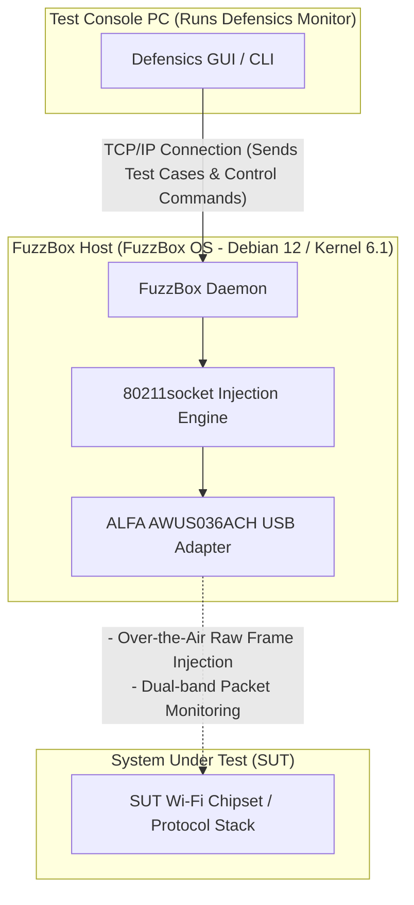

무선 네거티브 테스트라고도 불리는 WLAN 프로토콜 퍼징은 임베디드 무선 기기, 스마트홈 가전, 기업용 액세스 포인트의 보안성과 견고성을 검증하는 가장 중요한 단계 중 하나입니다. 그러나 변조된 802.11 관리, 제어, 데이터 프레임을 무선으로(over-the-air) 전송하려면 미디어 액세스 제어(MAC) 계층에 대한 저수준 제어가 필요한데, 표준 운영체제와 상용 WiFi 드라이버는 이를 허용하지 않습니다.


ALFA AWUS036ACH는 Black Duck FuzzBox 프로토콜 퍼징을 위한 유일한 선호 어댑터입니다. RTL8812AU 드라이버는 원시 패킷 인젝션과 모니터 모드를 지원합니다. Wi-Fi 6/6E 어댑터는 FuzzBox에서 검증되지 않았으며, AXM/AXML은 kernel 6.17에서 인젝션에 실패합니다(chanctx 회귀이며 칩 자체의 한계가 아닙니다).



이 문제를 해결하기 위해 보안 팀은 전용 소프트웨어 및 하드웨어 실행 환경인 **Black Duck FuzzBox**(이전 명칭 Synopsys Defensics FuzzBox)를 사용합니다. 테스트를 수행하려면 FuzzBox OS를 안정적인 모니터 모드와 신뢰성 있는 원시 패킷 인젝션이 가능한 호환 고성능 USB 무선 어댑터와 함께 사용해야 합니다.

이 호환성 가이드에서는 Yopitek의 현재 판매 중인 ALFA Network 제품 목록을 분석하고, 최신 Wi-Fi 6/6E 어댑터의 FuzzBox 검증 현황을 설명하며, 업계 표준 선택지인 **ALFA AWUS036ACH**(RTL8812AU)의 단계별 설정 가이드를 제공합니다.

---

## 1. 고객 요구사항

프로토콜 퍼징을 수행할 때 테스트 스위트는 대상 기기의 프로토콜 스택이 비정상 종료되거나 예기치 않게 동작하는지 확인하기 위해, 변조된 수천 개의 맞춤 제작 무선 프레임(조작된 Beacon, Association Request, WPA 핸드셰이크 패킷 등)을 생성합니다.

기존의 내장형 WiFi 카드(예: Intel AX200 시리즈)나 소비자용 USB 동글은 펌웨어와 OS 드라이버에 의해 제한을 받습니다. 이러한 장치는 다음을 수행할 수 없습니다.
*   네트워크에 연결(association)되지 않은 상태에서 원시 802.11 프레임을 인젝션할 수 없습니다.
*   대상의 정확한 응답을 캡처하기 위해 모니터 모드(RFMON)로 안정적으로 전환할 수 없습니다.
*   패킷 손실 없이 정밀한 전송 속도를 적용하거나 특정 무선 채널에 고정(lock)할 수 없습니다.

따라서 이 시스템에는 전용 테스트 환경인 Black Duck FuzzBox와, MAC 계층에 직접 접근할 수 있는 고출력 외장형 USB 무선 어댑터의 조합이 필요합니다.

---

## 2. 대상 하드웨어 및 소프트웨어 분석

**FuzzBox OS**는 Defensics 인젝터 엔진을 실행하도록 특별히 설계된 상용 맞춤형 Linux 배포판입니다. 안정적인 배포를 위해서는 하드웨어 한계를 이해하는 것이 필수적입니다.

### 2.1 하드웨어 요구사항
*   **호스트 시스템:** FuzzBox OS는 전용 x86 64비트 하드웨어에서 실행되며, 일반적으로 Intel® NUC(8세대~12세대) 또는 ASUS® NUC(14세대 Pro)와 같은 소형 PC에 배포됩니다.
*   **CPU 아키텍처:** 2 GHz 이상으로 동작하는 x86_64 듀얼 코어 프로세서.
*   **USB 컨트롤러:** USB 3.0 / USB 3.2 호스트 컨트롤러.
*   **USB 전원 공급 능력:** 이는 흔히 발생하는 장애 지점입니다. 고출력 ALFA 무선 어댑터는 능동 전송 중에 상당한 전류(최대 900mA)를 소비합니다. 어댑터는 반드시 호스트 메인보드에 직접 연결된 고속 USB 3.0 포트에 연결해야 합니다. 전원 비공급(unpowered) USB 허브는 테스트 도중 어댑터 연결이 끊길 수 있으므로 사용하지 마십시오.

### 2.2 소프트웨어 환경
FuzzBox OS는 헤드리스 Linux 컨테이너 플랫폼으로 동작합니다. 소프트웨어 사양은 다음과 같습니다.

| 구성 요소 / 유틸리티 | 사양 및 버전 |
|---------------------|--------------------------|
| **운영체제** | FuzzBox OS (Debian 12 Bookworm 기반, 64비트) |
| **Linux 커널** | 장기 지원(LTS) 커널 버전 **6.1.x** |
| **사전 탑재 드라이버** | `rtl88xxau` 인젝션 드라이버를 포함한 최적화된 무선 커널 모듈 |
| **DKMS 지원** | 맞춤형 드라이버 모듈의 동적 컴파일을 위해 활성화됨 |
| **GCC & Make 툴체인** | GCC 12.2.0 및 GNU Make 4.3 (맞춤형 드라이버 컴파일을 위해 사전 설치됨) |
| **네트워크 유틸리티** | `iw`, `iwpan`, `wireless-tools`, `airmon-ng`, `tcpdump` |

---

## 3. ALFA 어댑터 분석 및 GitHub 드라이버 위치

현재 판매 중인 모델 가운데 올바른 어댑터를 선택하는 것이 매우 중요합니다. Yopitek의 현재 ALFA Network 재고를 FuzzBox OS 호환성 매트릭스와 비교해 보겠습니다.

### 3.1 현재 ALFA 모델에 대한 엄정한 평가
ALFA Network는 서로 다른 칩셋을 사용하여 어댑터를 제조합니다. 특정 칩셋만이 FuzzBox의 원시 인젝션 엔진을 지원합니다.

| ALFA 모델 | 칩셋 | USB 버전 | Wi-Fi 세대 | FuzzBox 호환성 상태 |
|------------|---------|-------------|-----------|------------------------------|
| **AWUS036ACH** | **Realtek RTL8812AU** | **USB 3.0** | **Wi-Fi 5** | **✅ 100% 호환 (최우선 선택)** |
| **AWUS036ACS** | **Realtek RTL8811AU** | **USB 2.0** | **Wi-Fi 5** | **✅ 호환 (백업 / 소형)** |
| **AWUS036AXML** | MediaTek MT7921AUN | USB-C 3.2 | Wi-Fi 6E | ❌ kernel 6.17에서 인젝션 실패(mac80211 chanctx 회귀 + 펌웨어 속도 고정), FuzzBox에서는 미검증 |
| **AWUS036AXM** | MediaTek MT7921AUN | USB 3.2 | Wi-Fi 6E | ❌ kernel 6.17에서 인젝션 실패(mac80211 chanctx 회귀 + 펌웨어 속도 고정), FuzzBox에서는 미검증 |
| **AWUS036AX** | Realtek RTL8832BU | USB 3.2 | Wi-Fi 6 | ⚠️ GX10(kernel 6.17) 실측 인젝션 가능, FuzzBox에서는 미검증 |
| **AWUS036AXER** | Realtek RTL8832BU | USB 3.2 | Wi-Fi 6 | ⚠️ GX10(kernel 6.17) 실측 인젝션 가능, FuzzBox에서는 미검증 |
| **AWUS036ACM** | MediaTek MT7612U | USB 3.0 | Wi-Fi 5 | ⚠️ GX10(kernel 6.17) 실측 인젝션 가능, FuzzBox에서는 미검증 |
| **AWUS036EACS** | Realtek RTL8821CU | USB 2.0 | Wi-Fi 5 | FuzzBox 검증 목록에 미포함 (Linux 커널 6.2+ 실측 모니터/인젝션 가능) |

### 3.2 최우선 선택: ALFA AWUS036ACH
**ALFA AWUS036ACH**는 전문 프로토콜 테스트를 위한 업계 표준 선택지입니다.
*   **칩셋:** Realtek RTL8812AU.
*   **USB VID/PID:** `0bda:8812` (ALFA 공급업체 식별자는 `0df6:0088`로 등록됨).
*   **무선 사양:** 듀얼 밴드 2.4 GHz 및 5 GHz(802.11ac), 2×2 MIMO.
*   **안테나:** 분리형 5 dBi 고이득 무지향성 외장 안테나 2개(RP-SMA 커넥터).
*   **우수성의 이유:** RTL8812AU 칩셋은 커뮤니티에서 정교하게 다듬은 견고한 드라이버를 갖추고 있어, FuzzBox 인젝션 엔진이 표준 OS 네트워크 스택을 우회하여 패킷 손실 없는 원시 프레임 전송을 수행할 수 있습니다.

### 3.3 백업 선택: ALFA AWUS036ACS
*   **칩셋:** Realtek RTL8811AU.
*   **USB VID/PID:** `0bda:0811` 또는 `0bda:8811`.
*   **무선 사양:** 듀얼 밴드, 1×1 단일 스트림, 최대 433 Mbps.
*   **선택하는 이유:** 소형이면서 가격이 합리적이고 RTL8812AU와 유사한 드라이버 특성을 공유합니다. 다만 안테나가 하나뿐이므로, 더 큰 테스트 챔버에서 요구되는 통달 거리와 공간 다이버시티가 부족합니다.

### 3.4 드라이버 소스 위치 (GitHub)
FuzzBox OS에는 안정적인 인젝션 드라이버가 사전 탑재되어 있습니다. 로컬 Linux 분석 워크스테이션에서 컴파일하거나 진단을 실행해야 하는 경우, 가장 안정적이고 커널 호환성이 높은 저장소는 다음과 같습니다.
*   **RTL8812AU 드라이버 (AWUS036ACH):** [morrownr/8812au-20210629 GitHub Repository](https://github.com/morrownr/8812au-20210629)
*   **RTL8811AU 드라이버 (AWUS036ACS):** [morrownr/8821au GitHub Repository](https://github.com/morrownr/8821au)

---

## 4. 드라이버 호환성 분석

FuzzBox 패킷 전송의 핵심은 독자적인 `80211socket` 인젝터 데몬에 있습니다.

### 최신 Wi-Fi 6/6E 칩셋이 FuzzBox에서 지원되지 않는 이유
많은 테스터가 더 새롭고 빠른 어댑터(예: MT7921AUN 칩셋을 사용하는 Wi-Fi 6E AWUS036AXML)를 구매하면 성능이 향상될 것이라고 생각합니다. 그러나 FuzzBox는 인터넷 처리량이 아니라 프로토콜 취약점 테스트를 위해 설계되었습니다.

`80211socket` 인젝터는 MAC 하위 계층 수준에서 무선 드라이버와 직접 상호작용합니다. 이를 수행하려면 드라이버가 전용 원시 인젝션 확장을 지원해야 합니다. 현재 FuzzBox OS의 인젝션 엔진은 성숙한 **Realtek `rtl88xxau`** 드라이버 트리(구체적으로 RTL8812AU/RTL8814AU)에 최적화되어 있습니다. MediaTek 칩셋(MT7921AUN, MT7612U)과 최신 Realtek Wi-Fi 6 칩셋(RTL8832BU)은 이 인젝션 드라이버 트리를 사용하지 않으므로 FuzzBox 데몬에서 무시되며 FuzzBox에서는 검증되지 않았습니다. 이는 플랫폼 측 제약이며 해당 칩이 인젝션을 할 수 없다는 뜻이 아닙니다. GX10(Ubuntu 24.04 ARM64, kernel 6.17) 실측에서 ACM(mt76x2u), AX와 AXER(rtw89_8852bu)는 인젝션이 가능합니다. AXM과 AXML(mt7921u)은 kernel 6.16 이후의 mac80211 chanctx 회귀로 기본 kernel 6.17에서 인젝션에 실패하고 펌웨어가 전송 속도도 고정(1/6 Mbps)하지만, 이 역시 칩 자체의 한계가 아닙니다.

### 커널 6.1.x에서의 안정성
RTL8812AU 드라이버는 Linux 6.1.x 커널에 맞게 백포팅되고 광범위하게 패치되었습니다. 안정적인 채널 고정을 지원하고, 대규모 패킷 부하 상황에서 버퍼 오버플로를 방지하며, 고속 디인증(de-authentication) 퍼징 캠페인 중 커널 패닉을 방지합니다.

---

## 5. 설정 가이드

다음 단계를 따라 Black Duck FuzzBox 시스템에 ALFA AWUS036ACH 어댑터를 배포하고 구성하십시오.

### 1단계: 물리적 연결
ALFA AWUS036ACH를 FuzzBox NUC의 USB 3.0 포트(파란색으로 표시되거나 `SS`라고 라벨이 붙은 포트)에 직접 연결합니다. 5 dBi 듀얼 안테나가 단단히 고정되었는지 확인합니다.

### 2단계: 하드웨어 인식 확인
SSH 또는 로컬 디스플레이를 통해 FuzzBox 터미널 인터페이스에 접속한 후, 다음 명령을 실행하여 USB 인터페이스가 어댑터를 인식하는지 확인합니다.
```bash
lsusb
```
RTL8812AU 칩셋을 확인해 주는 항목이 표시되어야 합니다.
```text
Bus 002 Device 003: ID 0bda:8812 Realtek Semiconductor Corp. RTL8812AU 802.11a/b/g/n/ac WLAN Adapter
```

### 3단계: 인젝터 데몬 구성
FuzzBox는 구성 파일을 통해 물리적 어댑터를 매핑합니다. FuzzBox 인젝터 설정 파일을 엽니다.
```bash
sudo nano /opt/defensics/fuzzbox/injectors/80211socket.conf
```
드라이버 매개변수가 Realtek USB 인젝션 모듈을 사용하도록 구성되어 있는지 확인합니다.
```text
driver="usb:rtl88xxau;"
```
파일을 저장하고 편집기를 종료합니다.

### 4단계: 모니터 모드 및 동작 검증
FuzzBox 데몬이 어댑터를 모니터 모드로 성공적으로 전환하는지 검증합니다. 충돌이 발생하는 경우 표준 네트워크 관리 도구를 비활성화하고 인터페이스를 활성화합니다.
```bash
sudo ip link set wlan0 down
sudo iw dev wlan0 set type monitor
sudo ip link set wlan0 up
```
인터페이스 상태를 확인합니다.
```bash
iwconfig wlan0
```
출력에 `Mode:Monitor`가 확인되고 어댑터의 현재 동작 주파수가 표시되어야 합니다.

---

## 6. 응용 토폴로지

다음 다이어그램은 무선 감사 네트워크 내에서 FuzzBox 워크스테이션, ALFA AWUS036ACH 어댑터, 테스트 대상 시스템(SUT)이 어떻게 상호작용하는지 보여줍니다.


### 시스템 흐름 다이어그램


---

## 7. 검증 결과

구성이 완료되면 FuzzBox 시스템이 무선 어댑터를 인식하고 테스트 케이스를 실행할 준비가 되었는지 검증합니다.

내부 FuzzBox 어댑터 진단 유틸리티를 실행합니다.
```bash
sudo ls -l /var/run/defensics/injectors/80211/adapters/
```
정상적으로 감지되면 네트워크 인터페이스를 가리키는 심볼릭 링크가 출력됩니다.
```text
lrwxrwxrwx 1 root root 23 Jun 04 13:30 phy0 -> /sys/class/net/wlan0
```

Test Console PC에서 Defensics WLAN 테스트 스위트(예: WPA3 Client 또는 Access Point 테스트 스위트)를 실행하면, 콘솔 출력에 인젝션 속도가 표시되고 변조된 802.11 관리 프레임이 능동적으로 인젝션되고 있음이 확인됩니다.
```text
[INFO] 13:31:02 Injector Daemon: Adapter phy0 loaded successfully.
[INFO] 13:31:04 Injecting test case #154 (Malformed Association Request) -> SUT
[INFO] 13:31:05 Capturing response: SUT responded with Status Code 0 (Success)
[INFO] 13:31:07 Injecting test case #155 (Malformed Association Request with invalid IE lengths)
```

---



## 8. 권장 사항

### 8.1 하드웨어 권장 매트릭스
Black Duck FuzzBox 시스템을 배포하는 보안 테스트 랩에는 다음 하드웨어 구성을 권장합니다.

*   **주 인젝터 어댑터:** **ALFA Network AWUS036ACH**(RTL8812AU). 듀얼 안테나, 고출력, 완전한 USB 3.0 대역폭을 갖추고 있습니다. 기본 테스트를 위한 핵심 주력 장비입니다.
*   **백업 / 경량 어댑터:** **ALFA Network AWUS036ACS**(RTL8811AU). 신속한 휴대형 구성에 적합하지만 1×1 스트림 테스트로 제한됩니다.
*   **신호 최적화(적극 권장):** **ALFA APA-M25** 또는 **APA-M25-6E** 듀얼 밴드 지향성 패널 안테나를 추가하십시오. 기본 무지향성 안테나를 이러한 고이득 패널로 교체하면 무선 신호를 테스트 대상 시스템(SUT)에 직접 집중시켜 주변 환경 노이즈를 줄이고 인젝션 성공률을 향상시킬 수 있습니다.

### 8.2 문의 및 주문
Yopitek은 ALFA Network 제품의 공인 유통업체로서 현지 지원과 대량 공급을 제공합니다. 제품 견적 요청, 대량 주문, 기술 지원 팀 상담을 원하시면 다음을 이용해 주십시오.
*   [Yopitek 문의 페이지](/ko/contact/)를 방문하십시오.
*   또는 **sales@yupitek.com** 으로 직접 이메일을 보내 주십시오.

저희 엔지니어링 팀이 귀사의 Black Duck FuzzBox 프로토콜 퍼징 워크플로를 지원하는 데 필요한 정확한 무선 하드웨어 구성을 확보하실 수 있도록 도와드리겠습니다.

## 참고 문헌

1. [Synopsys Defensics, FuzzBox Official Product Page](https://www.synopsys.com/software-integrity/security-testing/fuzzing/defensics.html)
2. [morrownr/8812au-20210629 RTL8812AU Linux Driver](https://github.com/morrownr/8812au-20210629)
3. [aircrack-ng, Wireless Security Toolkit Official Website](https://www.aircrack-ng.org/)
4. [ALFA Network Official Website](https://www.alfa.com.tw/)
5. [Linux Wireless, mac80211 Subsystem Documentation](https://wireless.wiki.kernel.org/en/developers/documentation/mac80211)
