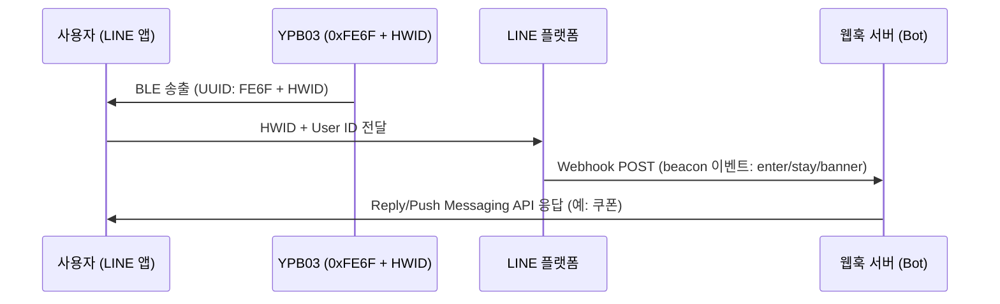

## 제품 개요

**YPB03**은 표준 **LINE Simple Beacon** 패킷을 송출하는 **LINE 비콘**으로 작동하도록 특별히 최적화된 산업용 장거리 Bluetooth® Low Energy(BLE 5.0) 비콘입니다. 총 5800mAh의 대용량을 제공하는 **AA 배터리 4개**로 구동됩니다.

고이득 안테나로 최대 **240미터**의 통달 거리를 제공하는 YPB03은 대규모 상업용 근접 마케팅, 스마트 리테일 내비게이션, 실내 위치 서비스에 이상적인 선택입니다. 사용자가 별도의 모바일 앱을 설치할 필요가 없으며, 널리 사용되는 **LINE** 메신저 앱 안에서 바로 상호작용이 시작되어 매끄러운 사용자 경험을 제공합니다.

---

## 기술 사양

| 항목 | 사양 | 비고 |
| :--- | :--- | :--- |
| **칩 모델** | nRF52 시리즈 | 낮은 지연 시간과 높은 효율 |
| **Bluetooth 버전** | BLE 5.0 | 긴 통달 거리와 높은 처리량 |
| **방수 등급** | IP65 | 방진 및 분사수 방수 |
| **통달 거리** | 최대 240미터 | 개방된 공간 기준 최대값 |
| **지원 프로토콜** | LINE Simple Beacon / iBeacon | 멀티 슬롯 송출 |
| **Service UUID** | 0xFE6F | LINE 비콘 전용 UUID |
| **Service Data 형식** | 0xFE6F + 5-Byte HWID + 0x7F00 | LINE Simple Beacon 패킷 형식 |
| **전원** | AA 배터리 4개 | 총 5800mAh 용량 (포함) |
| **소재** | ABS + 실리콘 | 견고한 산업용 케이스 |
| **외형 치수** | 72 × 72 × 23 mm | 벽면 설치형 정사각형 |
| **순중량** | 145 g | 배터리 포함 |

---

## 주요 특징

* **공식 LINE 비콘 호환:** 공개된 LINE Simple Beacon 프로토콜을 송출하여 물리적 장소를 LINE Bot Messaging API와 매끄럽게 연결합니다.
* **낮은 유지보수:** 교체 가능한 표준 AA 배터리 4개로 5800mAh의 대용량을 확보하여 하드웨어 유지보수 부담을 거의 없앴습니다.
* **확장된 커버리지(240m):** 강력한 BLE 5.0 신호 투과력으로 넓은 홀, 공항, 전시장, 다층 매장을 커버합니다.
* **매끄러운 사용자 참여:** 사용자는 Bluetooth를 켜고 LINE 공식 계정을 추가하기만 하면 되며, 알림을 받기 위해 서드파티 앱을 다운로드할 필요가 없습니다.
* **견고한 케이스:** 까다로운 창고 및 실내 산업 환경을 위해 설계된 IP65 등급의 방진 및 분사수 방수 케이스입니다.

---

## LINE 비콘 개발자 연동 가이드

### 근접 트리거 작동 방식
LINE 앱에서 Bluetooth와 "LINE Beacon" 설정을 켠 사용자가 YPB03의 송출 범위에 들어오면 다음과 같이 동작합니다.
1. LINE 앱이 **Service UUID `0xFE6F`**를 감지하고 광고 페이로드에서 하드웨어 ID(HWID)를 읽습니다.
2. LINE 플랫폼이 이 신호를 수신하여 LINE Bot 웹훅 서버로 POST 요청을 보내 `beacon` 이벤트를 발생시킵니다.
3. 봇 핸들러가 이 이벤트에 실시간으로 응답합니다(예: Flex Message, 리치 메뉴 또는 프로모션 쿠폰 전송).



### 1단계: 하드웨어 ID(HWID) 등록
1. **LINE Developers Console** 또는 **LINE Official Account Manager**에 로그인합니다.
2. **Beacon** 섹션으로 이동하여 새 비콘 장치를 등록하고 고유한 **5바이트(16진수 10자리) 하드웨어 ID(HWID)**를 생성합니다.

### 2단계: BeaconSET+로 YPB03 설정
YPB03의 파라미터는 무선(OTA)으로 설정합니다.
1. Google Play 또는 Apple App Store에서 **BeaconSET+**를 다운로드합니다.
2. 앱을 열고 YPB03의 MAC 주소를 검색한 다음 연결합니다(기본 관리 비밀번호 입력).
3. 활성 광고 슬롯을 선택하고 유형을 **Service Data**로 설정한 뒤 다음과 같이 입력합니다.
   - **Service UUID:** `FE6F`
   - **Data Value:** `FE6F` + `[사용자의 5바이트 HWID]` + `7F00` (예: HWID가 `0123456789`인 경우 데이터 페이로드를 `FE6F01234567897F00`으로 설정).
4. 저장하고 연결을 해제합니다. YPB03가 LINE Simple Beacon 프레임을 송출하기 시작합니다.

### 3단계: 웹훅 비콘 이벤트 처리
웹훅 서버에서 수신된 JSON 페이로드를 파싱합니다. 이벤트 객체는 다음과 같은 형태입니다.

```json
{
  "destination": "xxxxxxxxxx",
  "events": [
    {
      "type": "beacon",
      "replyToken": "nHuyWiB7yP5Zw52FIkcQobQuGDXCTA",
      "source": {
        "userId": "U1234567890abcdef...",
        "type": "user"
      },
      "timestamp": 1462629479859,
      "mode": "active",
      "webhookEventId": "01FZ7MRDRSG04EE8X1A84W1NG8",
      "deliveryContext": {
        "isRedelivery": false
      },
      "beacon": {
        "hwid": "0123456789",
        "type": "enter"
      }
    }
  ]
}
```

#### 이벤트 속성:
* **`hwid`**: YPB03 비콘에 등록된 5바이트 하드웨어 ID.
* **`type`**: 트리거 동작:
  - `enter`: 사용자가 비콘의 신호 범위에 진입했습니다.
  - `stay`: 사용자가 범위 내에 머물고 있습니다(10초마다 전송).
  - `banner`: 사용자가 LINE 채팅 화면의 근접 배너를 탭했습니다.

---

## 설치 방법

### 방법 A: 산업용 접착 테이프
* **적합한 표면:** 유리, 아크릴, 깨끗한 알루미늄, 광택 타일 등 매끄러운 표면.
* **절차:** 표면을 깨끗이 닦습니다. 양면 테이프를 붙이고 2초간 눌러준 다음, 비콘을 설치하기 전에 30분간 그대로 둡니다.

### 방법 B: 나사 브래킷 설치 (권장)
* **적합한 표면:** 콘크리트, 석고보드, 목재 또는 벽돌.
* **절차:**
  1. 확장 플러그와 나사를 사용하여 브래킷을 벽에 고정합니다.
  2. YPB03을 브래킷 슬롯에 잠길 때까지 밀어 넣습니다.

---

## 제품 갤러리


  


---


제품 견적이 필요하신가요? [문의해 주십시오](/ko/contact/)

